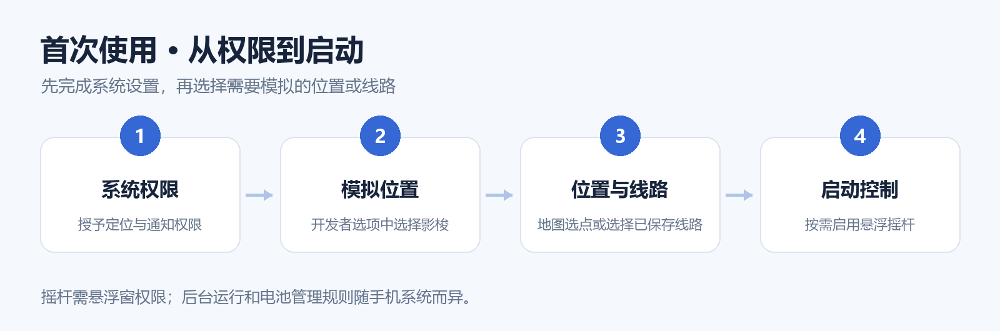

# 影梭

> **修改版声明**：本项目 fork 自 [ZCShou/GoGoGo](https://github.com/ZCShou/GoGoGo)，由 GitHub 用户 `123456533534` 于 2026-11-25 修改。主要改动：VirtGO 1.12.3 白系界面改版、新增多点路线规划与回放（画圈点对点连线、闭环圈数设置、收藏整条路线）、支持在设置页自主更改百度 AK 与安全码、修复地点搜索失败及画点过密问题。原项目 LICENSE（GPL-3.0）与版权声明保持不变。
>
> **版本说明**：本 fork 基于原项目**开源的 1.12.3 版本**（提交 `96139ee`），对应本仓库提供的 APK。它**不是**原作者后续发布的 v2.5.3 等新版本——那些新版仅以编译包（APK）形式发布，源码并未开源，因此不在本 fork 范围内。本页所述功能与截图均以 1.12.3 为准，请以本仓库代码和 Release 为准，不要与原项目最新版的说明混用。

影梭（VirtGO）是一款 Android 位置模拟应用，支持地图选点、位置搜索、坐标输入、线路移动和悬浮摇杆，并提供位置与线路的收藏和历史记录。“影”寓意位置的影子，“梭”寓意在位置与线路之间穿梭。

[查看发布版本](https://github.com/123456533534/VirtGO-1.12.3/releases) · [问题反馈](https://github.com/123456533534/VirtGO-1.12.3/issues)

## 1. 功能

以下功能描述依据本 fork 的 1.12.3 源码实际实现编写。原项目 README 中描述的 GPX 导入导出、夜间底图、独立安装实例、账号与会员等功能，1.12.3 中并不存在，已从本页移除。

### 1.1 位置选择与模拟

在位置页点击地图落点、搜索地点，或手动输入经纬度，选定后启动位置模拟。地图支持普通图与卫星图两种底图。

- 单击地图落点，或点顶部搜索栏搜索地点、点坐标按钮手动输入经纬度（BD09 / WGS84）。
- 长按地图触发反地理编码，查看地点信息。
- 点左侧开始/停止按钮控制模拟；已启动时再点地图新位置为“传送到新位置”。
- 保存常用地点到收藏，查看和重新选择位置历史。
- 在运行通知栏查看服务状态。

### 1.2 线路编辑与移动（本 fork 重点改动）

在位置页依次落多个点形成线路，可切换点模式（逐点点击）或画模式（按住地图滑动，按距离采样连续落点，首尾接近自动闭环）。线路可命名收藏、从收藏列表重新载入，运行时按节点连续移动。

- 点模式逐个添加节点；画模式沿手指轨迹落点并自动把相邻点连成折线。
- 撤销上一点、清空全部节点、查看线路距离与时长。
- 闭环线路可设置回放圈数（1–99），运行中修改实时同步。
- 命名并“收藏整条路线”；收藏列表支持单击载入、长按重命名/删除。
- 从悬浮窗直接开始/结束线路模拟。

### 1.3 悬浮摇杆

取得悬浮窗权限后，可通过悬浮摇杆控制移动方向，在查看其他页面时继续调整模拟位置。

- 摇杆样式可切换（设置项 `setting_joystick_type`），可显示或隐藏。
- 步行/跑步/骑行速度模式，以及各模式的步频、步幅等参数。
- 悬浮窗可拖动、收起与展开。
- 在系统允许的后台条件下维持位置模拟服务。

### 1.4 参数设置

设置页提供以下可配置项：

- 运动参数：步行/跑步步频与步幅、骑行速度、海拔高度、移动方向、定位精度、位置更新间隔。
- 随机偏移：经纬度的最大偏移范围、日志开关、历史记录有效期。
- 地图密钥：百度地图 AK 与安全码（也可填写高德、腾讯的 key），填写后需重启 App 生效。
- 关于：版本号与作者信息。

这些参数是否被目标应用采用，取决于系统与应用自身逻辑。

### 1.5 修改版新增功能

本 fork 在原版基础上新增/强化了以下能力：

- **画圈点对点连线**：位置页切换到画模式后，沿手指轨迹按距离采样落点，相邻点之间自动以折线连接；起笔与收笔足够接近时自动判定闭环，把首尾连接起来形成闭合路线。点数较多时只保留折线、隐藏逐个编号，避免画面被标记淹没。
- **圈数设置**：闭环路线可设定回放圈数（1–99），运行中修改会实时同步到模拟服务，悬浮窗回放立即按新圈数执行。
- **收藏整条路线**：路线栏的「收藏整条路线」可为当前整条路线命名并保存；收藏列表支持单击载入、长按重命名与删除，重新打开时直接回填到画布。
- **可自主更改百度 AK**：设置页可填写自己的百度地图 AK 与安全码，无需改代码或重新打包；地图 SDK 只在进程启动时读取，改完需重启 App 生效。

## 2. 安装与启动

当前维护版本面向 Android 10 及以上系统，正式发布包使用 ARM64（`arm64-v8a`）架构。历史发布版本的系统要求可能不同，下载时以对应版本说明为准。

### 2.1 取得应用

从 [GitHub Releases](https://github.com/123456533534/VirtGO-1.12.3/releases) 选择需要的版本，在 Assets 中下载 APK 并安装。应用内“关于影梭”可查看当前版本和检查更新。

### 2.2 配置权限

位置模拟通过 Android 的模拟位置接口工作，通常不需要 Root。首次使用时，需要按应用提示授予定位权限，并在系统开发者选项中将影梭选为“模拟位置信息应用”；使用摇杆还需要允许悬浮窗。

完成配置后，回到影梭选择一个位置或线路并启动。模拟位置应用的设置入口、后台运行与电池管理规则会随手机系统不同而变化。

### 2.3 运行条件

后台持续运行、通知和定位权限会影响模拟服务的可用性。模拟位置应用需在系统开发者选项中指定；不同手机系统的后台保活与电池管理规则不同，可能影响服务持续运行。

## 3. 使用与反馈

位置模拟适合应用开发、地图与定位流程验证等场景。设置模拟位置不代表所有应用都会采纳相同结果，系统定位策略、坐标系、缓存和目标应用自身逻辑都可能影响显示。

### 3.1 定位结果检查

遇到位置偏差或未生效时，先检查模拟位置应用设置、定位权限和后台运行状态，再停止并重新启动模拟，在目标应用中刷新位置。地图显示坐标与系统位置坐标可能使用不同坐标系，不宜只比较界面上的数字判断是否出错。

### 3.2 问题反馈

通过 [GitHub Issues](https://github.com/123456533534/VirtGO-1.12.3/issues) 或应用内“帮助与反馈”提交问题时，请提供影梭版本、手机型号、Android 版本、使用的位置或线路模式、权限状态与复现步骤。分享截图或录屏前，请检查是否包含家庭地址等个人信息。
